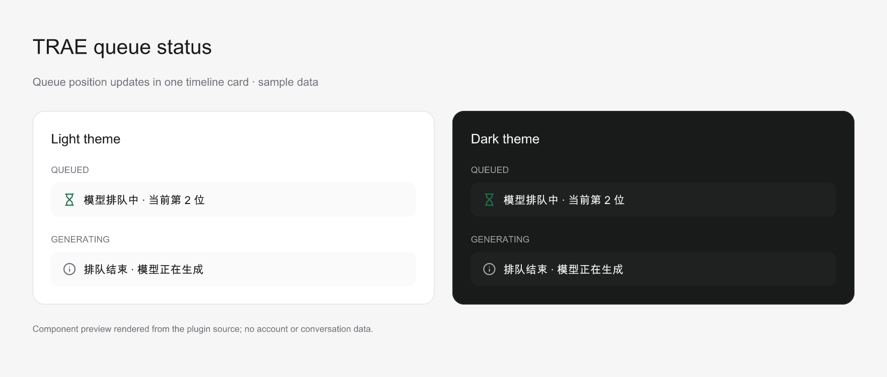

# Paseo TRAE queue status

English | [简体中文](README.md)

Paseo TRAE queue status is a trusted local [Paseo](https://paseo.sh) plugin that runs TRAE CLI as
an ACP provider and displays backend model queue state in the agent timeline. Queue position
changes update one status card instead of appending a new message every second.



Component preview rendered from the plugin's queue card with sample data. It is not a full-app
screenshot and contains no account or conversation data.

## Documentation and community

- [Documentation](#usage)
- [Feedback](https://github.com/tenlee2012/paseo-trae-queue-status/issues)

## Requirements

- Paseo `>=0.13.0` on the daemon and connected app. Plugin `0.3.0` uses the new panel API.
- Node.js `>=20.19.0` on the daemon and npm for installing runtime dependencies from Git.
- A recent TRAE CLI with `traecli acp serve` and the experimental
  `headless_queue_status` feature.
- For active-turn steering, TRAE CLI must advertise `_meta.steering.supported` during ACP
  initialization. The plugin enables steering only when this capability is present.
- TRAE CLI authentication completed for the operating-system user that runs the Paseo daemon.
- `traecli` installed on the daemon machine, discoverable through `PATH`, common install directories, or `TRAECLI_BIN`.
- Git access from the daemon machine to this GitHub repository.

Check the TRAE CLI installation before installing the plugin:

```bash
command -v traecli
traecli --version
traecli login status
traecli features list | rg headless_queue_status
```

## Install

Plugins are trusted, unsandboxed code. The server entry can access files, processes, credentials,
and network services as the daemon user. Inspect the repository before installing it.

Enable plugins under **Settings → Plugins** on the target host, then install from GitHub:

```bash
paseo plugin install \
  git:https://github.com/tenlee2012/paseo-trae-queue-status.git
```

The same source can be pasted into **Settings → Plugins → Plugin source**:

```text
git:https://github.com/tenlee2012/paseo-trae-queue-status.git
```

Confirm that both the plugin and provider are ready:

```bash
paseo plugin ls
paseo provider diagnostic traecli-queue --json
paseo provider models traecli-queue --json
```

Install with the manifest's default ID, `trae-queue-status`. Do not use `--id` to rename this
plugin because its provider timeline items and client renderer share that ID.

## Subagent display

Native TRAE children appear in Paseo's **Subagents** composer entry with names, tasks and status.
Open a child to view its live messages, reasoning and tools. Nested children retain their direct
parent; background children complete independently. Child sessions are read-only views owned by
the parent runtime; send follow-up assignments through the parent.

Verified with TRAE CLI `0.214.1-alpha.2` and a local mock model. This uses ACP's
`_meta.traex` metadata (`subagent_control` and `subagent_child`); older CLIs without it retain
ordinary tool display. Restoring a parent rebuilds the child list and reads final results from
linked local child rollouts. The current CLI does not replay full child transcripts. Unconfirmed
historical completion states appear stopped. Reads respect `TRAE_HOME` and `TRAECLI_HOME`.

## Use

1. Create a new Agent in Paseo.
2. Select **TraeX** as the provider.
3. Select a model exposed by your TRAE CLI account.
4. Choose the permission mode and thinking level you want.
5. Send the task.

The composer prefers TRAE CLI's native **Collaboration mode** selector with **Default / Plan**.
When available, it replaces the plugin's Plan icon button; permission changes apply independently.
Saved legacy `plan_mode` values map to native collaboration settings. If both settings are present,
`collaboration_mode` takes precedence. Restoring a legacy read-only Plan session migrates it to native
Plan with Workspace Edit permissions before applying saved permission choices. Failed migration restores
the legacy read-only permission and reports an error.

Older CLIs without Collaboration mode retain the separate **Plan** icon button when they advertise
Plan support. Enabling it uses the native read-only planning permission; disabling it restores the
selected permission. Changing permissions while Plan is enabled selects the permission to use after
leaving Plan. When a native session resumes in Plan without a saved permission selection, leaving Plan
uses Workspace Edit. The permission menu contains only choices such as Workspace Edit, Auto, and Full
Access. The two planning controls never appear together.

After the Agent session opens, use **Context** in the composer to choose **Standard** or **Max**.
Max appears only when TRAE CLI advertises it for the selected model. Switching context preserves a
compatible thinking level; if the level is unavailable in the new context, the selector shows the
first level advertised by TRAE CLI. Selecting a model without Max restores Standard. Restored
sessions retain their native context selection. This control is available in the session composer,
not the new-Agent form.
During session creation or restoration, a saved Max setting falls back to Standard if the selected
model's native variants do not support Max. This prevents inherited settings from blocking an
immediate first message to a model without Max support. The fallback applies only during startup and preserves
Max when the current native session supports it.

The plugin provides its own `paseo_questions / AskUserQuestion` tool. It shows the same question
card used by Codex in **Default, Full Access, and Plan** modes. Choose an option, select multiple
options, or enter a custom answer under Other. Submitting returns answers to the waiting TRAE
tool; dismissing the card or stopping the turn cancels the question. Default and Full Access
were used with TRAE CLI `0.210.1-alpha.3`.

Each connection runs a loopback MCP service with random per-session URLs. Only the built-in
question tool is approved once per execution through ACP; the session's permission mode is preserved.
The plugin no longer uses the ignored MCP `--allowed-tool` override. Answers still require user input. Native
blocking ACP forms also use these cards. Native GPT non-blocking `request_user_input` calls are
not forwarded over ACP, so the plugin guides models to its own tool. Start a new session or
reconnect an existing one after loading the update to register it.

From `0.3.3`, if a retired global default model prevents ACP from creating or restoring a session,
the plugin selects a candidate with a configuration ID and no known exhausted quota from the account's
model list, restarts ACP with a temporary override, and retries once. Catalog discovery uses the same
recovery path so the model picker remains accessible. Global configuration is preserved, and the model
explicitly selected in the UI is applied after the session opens. If recovery is unavailable or fails,
the error retains TRAE's detailed reason.

Model choices, thinking levels, and context capabilities come from the current CLI's responses.
Model names include the load reported by TRAE, for example **Example Model 🔴 214%**. Loads below
100% use 🟢, 100% through 150% use 🟡, and loads above 150% use 🔴. Missing load data omits the load
indicator; values above 100% are displayed as reported. Models with weekly quotas also show the
remaining percentage, for example **Example Model 🟢 20% · 周剩余 40%**. These are TRAE account
quota balances, not remaining request or token counts; unavailable balances omit their suffixes.
Every 30 seconds the plugin reads `traecli models --json`. This read-only query creates no sessions
or model requests. Results update session labels and model catalogs in connected clients,
respecting TRAE's cache policy. Failed reads retain the last result without interrupting tasks.
Menu refresh pauses when the client closes or the operating system suspends it; background load
reads continue for existing sessions.

### Model status panel

Open **TraeX 模型状态** from the top of the main sidebar, workspace panels or Explorer, or search for **TraeX** in
Command Center (⌘K / Ctrl+K). The panel shows model loads and weekly quotas for the TRAE
account on the current daemon. Search by name or ID, filter busy models or models with weekly quotas,
and sort by load, weekly remaining quota, name, or daily/weekly usage. Unsorted columns show muted ↑↓ arrows;
the sorted column uses the main foreground color for a single ↑ or ↓. Click its header to toggle ascending or descending order.
Usage sorting compares exact token counts; missing loads and quotas stay last in both directions.
Scroll horizontally on narrow screens. Each tab saves its search, filters, and sorting
independently and restores them after an app reload.

Click **问题反馈** (Feedback) at the top of the panel to open GitHub Issues for questions and suggestions.

Each model also shows today's and this week's token usage: input plus output, including cached
input. Reasoning tokens are already part of output and are not added again. Standard and Max
modes are combined. Days start at midnight and weeks at Monday midnight in the daemon's local
time zone, which is displayed with the usage update time. Counts come from local TRAE CLI session
and archive records, including subagents, attributed to the model used for each request.
Counts use decimal K, M, B and larger units with up to two decimal places, such as `1.23K`, `27.12M`, and `1.23B`.
Below each total, a second line shows cached input, new tokens (total minus cached input), and
the cached share of total usage. Records without cache data show that the breakdown is unavailable.
These are local usage counts, not an account bill: they include any accounts used on this host
and exclude other devices and deleted records. `TRAE_HOME` and `TRAECLI_HOME` are respected.
After the initial scan, appended records are read incrementally with a separate 30-second cache.
Unreadable or unattributable usage produces an error instead of being reported as zero.

The panel refreshes every 30 seconds while open and shares the provider's query cache;
manual refresh also respects that 30-second cache. Failed reads retain the last successful
snapshot with a warning and update timestamp. Missing metrics remain unknown, rather than
being treated as zero load or unlimited quota. Some CLI rows may not be selectable through
ACP; use the session model menu to switch models. Closing the panel stops its polling.

The panel, Command Center entry, and TraeX provider share the mark from the
[TRAE website](https://www.trae.cn/), rendered in black on a white rounded tile.
The panel uses Paseo 0.13 UI components. Queue cards use host icons
and still update their text immediately. Tab persistence stores display preferences only,
not live model metrics or queue history.

### Import existing sessions

Open **导入 TraeX 会话** from the destination workspace's panels or Explorer, or search
for **导入 TraeX 会话到当前工作区** in Command Center (⌘K / Ctrl+K). The panel shows the destination
workspace and directory. Search saved TRAE CLI conversations on the daemon machine from any
original directory, then choose **导入到此工作区** to import and open one.

Search immediately filters loaded conversations and queries further matches after
typing pauses. The input keeps focus and matching results stay visible with an inline progress
indicator. Refresh shows its progress and the last update time; failed refreshes keep the previous
list available for retry.

The plugin hides conversations already open in any Paseo workspace by their native
session ID. The backend also rejects stale selections and concurrent imports. Close the existing
conversation before importing again. If an external TRAE CLI or another client still owns the
writer, the error asks you to close that conversation instead of showing only `Internal error`.

Close a conversation in A, open this panel in B, and import it to display and run it in B while
preserving its native session ID and history. A's old card stays archived. Both listing and import
carry the explicit workspace ID; the backend refreshes that workspace's directory and binds the
restore handle to it. Closing and reimporting into the same destination restores that directory's
card. Legacy persistence remains readable.

Paseo's built-in **Import session → This workspace** only lists conversations whose
original directory matches the current workspace, recognizing symlink aliases and excluding parent
and child directories. **Show all** includes other directories and imports into the original
directory; use the plugin panel to import across directories into the current workspace.
The panel supports search, refresh and loading more
sessions. Native pagination includes empty pages with a next cursor, and search and internal-session
filters apply before the result limit. Previews identify a different source directory, recognizing
symlink aliases.

Previews come from the first user message in the local rollout. Legacy and paginated histories are
supported; reads are limited to the first 1 MiB per file and skip injected environment context.
Sessions without a readable preview remain importable. Old appended question-tool instructions
are removed from displayed titles, previews, and replayed user messages without changing the files.
New messages receive tool guidance through MCP rather than appended user text.

Import resumes the original session. Close it in its original client first if another CLI process
still holds its writer lock, then retry the import.

### Queue status

When the backend queues the model request, the timeline shows one updating card such as:

```text
Too many current requests. Your queue position is 79. Please wait for a while.
```

Later position updates replace that row in place. Repeated identical updates are discarded. When
the backend reports that queueing has ended, the same row changes to the terminal queue state. If a
request does not enter the backend queue, no queue card is shown.

### Send another message without interrupting

While a request is queued or running, send another message with Paseo's **Send and steer** behavior.
The plugin calls TRAE CLI's `_session/steering` extension and accepts the message only when TRAE
returns `outcome: injected`. The original turn keeps running and is not canceled or replaced.

The plugin advertises `prompt.steer` only when TRAE CLI reports steering support during ACP
initialization. Older TRAE CLI versions keep the provider usable for normal prompts but do not
offer active-turn steering.

### Per-turn token usage

Starting with `0.5.0`, each completed TraeX turn adds a compact usage row below the reply,
showing `本轮:`, the brain and tool icons with `N calls`, then the token icon and compact total.
The total has a themed dotted underline to indicate interaction. Hover over or keyboard-focus the token icon or total to see input, cache reads, cache creation,
output, reasoning, and total tokens. Only the token group opens this detail view; activity counts
stay directly visible. Moving onto the tooltip keeps it open for reading or selecting numbers.
Touch clients can tap the same trigger for a detail dialog. The desktop tooltip escapes scroll
clipping, avoids viewport edges, and closes on Escape, scrolling, or resizing.
Input, output, and reasoning percentages use total tokens; cache percentages use input tokens.
Percentages use raw counts with one decimal place; a zero denominator shows an em dash.
The row stays on one line and scrolls horizontally on narrow screens. Missing cache creation or
reasoning details, including fields absent from old rows, remain unavailable rather than zero.
Text, SVG icons, inputs, and detail surfaces follow Paseo's light and dark theme colors. Open
tooltips and detail dialogs update immediately when the theme changes.
From `0.5.1`, the brain icon counts model requests using the platform trace definition, including requests with
no visible Thinking text. Tools include both outer `exec` calls and their nested dispatches: one
`exec` calling two tools counts as three. Repeated status updates and resumed code cells count once;
started calls that fail or are canceled are included. Separate subagent sessions are excluded.
Counts come from native trace IDs and turn IDs, rather than ACP's incomplete timeline projection.
Trace schema 1 was checked with TRAE CLI `0.214.1-alpha.2`. Missing or incomplete traces show `—`
instead of a partial count or zero. Reliable call counts remain visible when token records cannot
be read. Legacy Thinking/ACP tool counts are not presented as platform statistics or backfilled.
The plugin gives newly launched CLI processes a private temporary trace directory. It discards
native raw payload files every second and removes the directory on connection close. The parser
does not read payload files and retains only counting IDs in memory; only counts reach the client,
with no additional trace upload. An existing `TRAECLI_ROLLOUT_TRACE_ROOT` is respected and its files
are left intact.
One turn includes every model request
in the current native session until completion, failure, or cancellation, including generation
after tool calls. Steering messages stay in the same turn. Separate subagent sessions are excluded.

Total tokens are input plus output. Input includes history, system instructions, tool results,
and cached input; cache creation is also part of input, and reasoning tokens are already included
in output. Neither cache nor reasoning
is added twice. The provider reads only the matching local session record, respects `TRAE_HOME`
and `TRAECLI_HOME`, and bypasses the model panel's 30-second usage cache.

The row initially shows usage pending and retries delayed file writes for up to five seconds,
updating the same row. Missing, unreadable, or unsupported records show usage unavailable rather
than zero. Missing cache details do not hide known input/output counts. Failed and canceled turns
show their outcome and any recorded usage. Only new turns completed while the plugin is loaded
are counted; imported historical replies are not backfilled.

### Session lifetime tokens

A **database icon + 1.23M** pill beside Tasks / Subagents shows the current native conversation's
lifetime input plus output, including cached input and without adding reasoning twice.
It includes requests across model switches and restores historical usage when a session is
resumed or imported; separate subagent sessions are excluded. It does not reset daily or weekly.

Click the icon or count for a popover with input, cache reads, cache creation, output, reasoning,
and total tokens. Input, output, and reasoning shares use the total; cache shares use input.
Percentages show one decimal place. Cache is included in input and reasoning in output.
Details missing from any historical request remain unavailable. Desktop uses an anchored popover;
compact layouts use a bottom sheet.

While visible, the pill and popover refresh every five seconds and query on session status changes.
The pill, tooltip, and popover share the same compact number format. The daemon uses a separate
one-second cache and reads appended records incrementally after the initial scan. Missing or
unreadable usage shows **—**, rather than zero. Leaving the conversation stops its
polling; plugin teardown removes registrations and subscriptions. These reads never prompt a model.

### Estimated costs

Turn and session costs appear only in detail popover total rows as `728.41K | $50.2`;
the timeline and composer pill show token counts only. Daily and weekly totals keep their costs
in the model status panel. USD costs reuse the token number formatter,
including compact K/M units and up to two decimal places. Raw costs are summed before formatting.
Opening a turn detail with an unknown cost recomputes it from that session's request records,
retrying every five seconds while open until a price is available. New rows retain native turn IDs;
older rows require a unique exact token-breakdown match. Ambiguous rows remain unknown.

Prices come from [Models.dev](https://models.dev/api.json), in USD per million tokens. Each request
prices uncached input, cache reads, cache creation and output separately, without double counting
cached input or reasoning. Context tiers use each request's input size, not accumulated totals.
Model IDs/names match case-insensitively, `__max` uses the base model, and canonical provider prices
take precedence over ambiguous reseller prices. Missing prices or billing details show `$—` while
preserving token totals; an unknown request makes its combined cost unknown.
DeepSeek-V4.1-Flash resolves to the official `deepseek-flash` API entry. DeepSeek's automatic cache
creation uses the ordinary cache-miss input price when the catalog has no separate write price;
an explicit write rate takes precedence. All rates continue to come from Models.dev.

All readers share a persistent 24-hour cache at
`$XDG_CACHE_HOME/paseo-trae-queue-status/models-dev-prices.json` (default cache root: `~/.cache`).
The first query after expiry refreshes it; concurrent reads share one download. A failed refresh
retains the last successful prices and permits a retry after five minutes. Only public pricing is
cached, with an in-memory fallback if the cache directory is not writable. These are estimates at
current standard prices, not TRAE invoices or historical rates; platform discounts, priority
service and different cache retention periods are not included.

## Custom TRAE CLI binary

The plugin locates `traecli` in this order. ACP sessions and model load refreshes share the resolved executable:

1. `TRAECLI_BIN` in the daemon environment. An explicit setting never falls back to another installation.
2. The daemon process `PATH`.
3. Common install directories. On macOS/Linux these include `~/.local/bin`, `~/bin`,
   `~/.trae/bin`, `/opt/homebrew/bin`, `/usr/local/bin`, system bin directories, user npm
   directories, Volta, asdf, and installed nvm Node versions' bin directories. On Windows,
   these include the user's `.local\bin`, `bin`, `%APPDATA%\npm`, and Scoop shims.

The scan only checks these directories for `traecli`; it does not recursively search the disk.
Successful resolution is cached. A failed lookup lists the searched directories and can be retried
after installation. All paths belong to the daemon machine, independently of the client machine.

To specify another binary, set `TRAECLI_BIN` in the environment that starts the Paseo daemon:

```bash
TRAECLI_BIN=/absolute/path/to/traecli paseo start
```

For a supervised or desktop-managed daemon, configure the environment in that daemon's launch
environment and reload the plugin afterward:

```bash
paseo plugin reload trae-queue-status
```

Shell aliases and functions are not executable paths. `TRAECLI_BIN` must name an executable file
or a command discoverable through `PATH`.

## Update

Check for and install the latest revision from the repository:

```bash
paseo plugin update trae-queue-status
```

An update reloads the plugin and closes active sessions owned by this provider. Update when its
agents are idle.

## Troubleshooting

### Provider is missing

```bash
paseo plugin ls
paseo plugin logs trae-queue-status
paseo provider diagnostic traecli-queue --json
```

Verify that the plugin reports `running`, the daemon and app satisfy the Paseo version requirement,
and `traecli` is available to the daemon user.

### The provider works but no queue card appears

The card is emitted only when TRAE CLI receives backend queue-status metadata. A request that starts
immediately does not produce a card. Confirm that the child process has the feature enabled:

```bash
traecli --enable headless_queue_status features list | rg headless_queue_status
```

### Paseo reports `ACP session does not expose mode configuration`

This error concerns initialization of the session permission mode, such as Auto. The plugin supports
both legacy `modes` and a `mode` selector exposed only through `configOptions`. For the latter, it
calls `session/set_config_option` with the declared config ID and verifies the returned permission.
If both forms of permission metadata are absent, it confirms Workspace Edit through the native API
before applying the user's selected mode. A native refusal remains an error.

Native model configuration takes precedence; missing fields use the [capability table](server/model-capabilities.ts).
The table covers all 25 models and 118 native variants returned by TRAE CLI `0.211.1-alpha.2` on
`2026-10-22`, including the custom models in that catalog. It records reasoning levels and Standard/Max
context support, and only augments models already exposed by the current account. Explicit empty
native choices and `supportsMaxMode: false` remain authoritative. Unknown models keep their native
configuration. Add new models to the table and captured capability tests as the CLI evolves.

If the error persists, compare the TRAE CLI version, resolved executable path, and plugin revision
on the daemon machine. Check whether `session/new` or `session/load` returns either permission
configuration. A model without adjustable reasoning or Max context can still support permissions.

### Paseo reports `Provider does not support prompt.steer`

Update TRAE CLI and reload the plugin:

```bash
traecli update --channel stable
paseo plugin reload trae-queue-status
paseo provider diagnostic traecli-queue --json
```

The plugin does not infer steering from the TRAE CLI version. It exposes `prompt.steer` only when
the ACP `initialize` response explicitly contains `_meta.steering.supported: true`.

### The card says the renderer is unavailable

The server and client contributions must come from the same installed plugin ID. Remove any install
that used a custom `--id`, install again with the default ID, and reopen the Agent page.

### Existing duplicate notifications remain

Versions before `0.1.0` emitted ordinary notification rows that could not be updated. Historical
rows remain in old timelines. New queue cycles use an identity-preserving plugin row and update in
place.

## Remove

Removing the plugin stops its provider sessions but does not delete TRAE CLI configuration or
credentials:

```bash
paseo plugin remove trae-queue-status
```

## Development

Install development dependencies and run all checks:

```bash
npm ci --legacy-peer-deps
npm run format
npm run lint
npm run typecheck
npm test -- --bail=1
npm pack --dry-run
```

Paseo supplies `@getpaseo/plugin`, React, React Native, TanStack Query, and Zod at runtime. The packages in
`devDependencies` exist only for local typechecking and tests; they are not bundled into the plugin.

## Security and data flow

- The daemon-side plugin launches a local TRAE CLI child process and exchanges ACP JSON-RPC over
  standard input and output.
- The plugin reads queue metadata from `session_info_update._meta.trae.queueStatus`. It also bridges
  the composer's model, context, and thinking controls to TRAE CLI's advertised ACP model IDs.
  Other ACP traffic passes through unchanged.
- Active-turn messages use the TRAE-specific `_session/steering` request. Its response is consumed
  inside the plugin and is not forwarded into the standard ACP SDK stream.
- Queue state is rendered only in connected Paseo clients. Cost estimates download public pricing
  from `https://models.dev/api.json`; requests contain no credentials, conversation content or usage data.
- Malformed or unknown queue metadata is ignored without interrupting the agent session.

## License

Apache-2.0. See [LICENSE](LICENSE).
