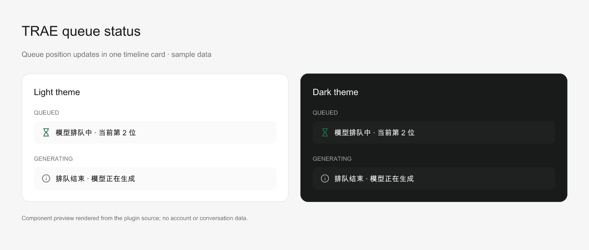

# Paseo TRAE 排队状态插件

简体中文 | [English](README.en.md)

Paseo TRAE 排队状态插件是一个受信任的本地 [Paseo](https://paseo.sh) 插件。它通过 ACP
运行 TRAE CLI，并在 Agent 时间线中展示后端模型的排队状态。队列位置变化时会更新同一张
状态卡，而不是每秒追加一条新消息。



此图使用插件的真实队列卡片组件与示例数据导出，是组件预览，并非完整应用截图，不包含账号或会话数据。

## 文档与交流

- [使用文档](#使用方法)
- [问题反馈](https://github.com/tenlee2012/paseo-trae-queue-status/issues)

## 前置要求

- daemon 和连接到它的 App 均使用 Paseo `>=0.13.0`。插件 `0.3.0` 起使用新版面板 API。
- daemon 运行环境使用 Node.js `>=20.19.0`，Git 安装时需要 npm 安装运行时依赖。
- TRAE CLI 支持 `traecli acp serve` 和实验性 `headless_queue_status` 功能。
- 如需在活动 turn 中继续追加消息，TRAE CLI 必须在 ACP 初始化时声明
  `_meta.steering.supported`。插件只会在该能力存在时启用 steering。
- 运行 Paseo daemon 的系统用户已经完成 TRAE CLI 登录。
- daemon 所在机器已安装 `traecli`，可通过 `PATH`、常见安装目录或 `TRAECLI_BIN` 找到。
- daemon 机器具有此 GitHub 仓库的 Git 访问权限。

安装插件前检查 TRAE CLI：

```bash
command -v traecli
traecli --version
traecli login status
traecli features list | rg headless_queue_status
```

## 安装

插件是受信任的非沙箱代码。服务端入口拥有 daemon 用户的权限，可以访问文件、进程、凭据
和网络服务。安装前请先检查仓库代码。

在目标主机的 **Settings → Plugins** 中启用插件总开关，然后从 GitHub 安装：

```bash
paseo plugin install \
  git:https://github.com/tenlee2012/paseo-trae-queue-status.git
```

也可以将下面的地址粘贴到 **Settings → Plugins → Plugin source**：

```text
git:https://github.com/tenlee2012/paseo-trae-queue-status.git
```

确认插件和 Provider 均已就绪：

```bash
paseo plugin ls
paseo provider diagnostic traecli-queue --json
paseo provider models traecli-queue --json
```

请使用 manifest 中的默认 ID `trae-queue-status` 安装。不要通过 `--id` 重命名插件，因为
Provider 时间线条目和客户端 renderer 共用该 ID。

## Subagent 展示

TRAE CLI 的原生子智能体会出现在 Paseo 输入区的 **Subagents** 入口中，展示名称、任务与状态，
点击可查看子会话。实时子消息、思考和工具调用归入对应子会话，支持嵌套子任务；后台任务独立结束。
子会话由父 TRAE 进程管理，目前作为只读会话展示，继续分派任务请在父会话中操作。

此适配已用 TRAE CLI `0.214.1-alpha.2` 和本机模拟模型验证，依赖 ACP 的
`_meta.traex` 的 `subagent_control / subagent_child` 元数据。旧版 CLI 未提供元数据时保留普通工具展示。
恢复父会话时重建子任务列表，并只读对应本地子会话的最终结果；当前 CLI 不回放完整子会话过程。
缺少或无法确认的历史结束状态显示为已停止。会话文件读取遵循 `TRAE_HOME` / `TRAECLI_HOME`。

## 使用方法

1. 在 Paseo 中创建一个新 Agent。
2. Provider 选择 **TraeX**。
3. 选择当前 TRAE CLI 账号可用的模型。
4. 选择需要的权限模式和思考等级。
5. 发送任务。

`0.3.3` 起，全局默认模型下线导致 ACP 无法创建或恢复会话时，插件会从当前账号的模型列表中
选择有配置 ID 且未耗尽额度的候选模型，临时重启 ACP 并重试一次。模型发现也使用此恢复路径，
因此仍可在 UI 中选择其他模型。全局配置不会被改写，UI 显式选择的模型仍会在会话建立后应用。
没有可用候选、模型列表读取失败或重试失败时，错误会保留 TRAE 返回的具体原因。

插件提供独立的 `paseo_questions / AskUserQuestion` 工具，在 **普通、Full Access 和 Plan**
模式都能显示与 Codex 共用的问题卡片。可以直接点选、多选，或在「其他」中输入答案；
提交后答案回到等待中的 TRAE 工具。关闭卡片或停止任务会取消待答问题。
普通及 Full Access 模式已使用 TRAE CLI `0.210.1-alpha.3`。

每个连接启动本机回环 MCP 服务，使用按会话随机生成的地址，只允许内置提问工具自动调用，
不会改变当前权限模式。插件通过 ACP 对此工具的执行请求作单次批准，不再使用已失效的
`--allowed-tool` MCP 参数；问题答案仍由用户提交。TRAE 的原生阻塞 ACP 表单也会显示为选择卡片；GPT 普通模式的
非阻塞 `request_user_input` 不会经 ACP 转发，因此插件引导模型使用独立工具。
加载新版后新建会话，或让已有会话重新连接，以注册该工具。

可以发送以下提示测试：

> 请调用 AskUserQuestion，问我喜欢哪个季节，提供春天和秋天两个选项。

输入区优先使用 TRAE CLI 提供的 **Collaboration mode**，通过 **Default / Plan** 切换协作模式；
此时隐藏插件原来的 Plan 图标按钮，权限选择独立生效。保存的旧版 `plan_mode` 会映射到原生
协作模式；两项配置同时存在时，以 `collaboration_mode` 为准。恢复旧版只读 Plan 会话时，
先迁移到原生 Plan，权限默认使用 Workspace Edit，再应用已保存的权限选择；迁移失败则
恢复旧版只读权限并报告错误。

旧版 CLI 未提供 Collaboration mode、但声明支持 Plan 时，仍显示独立的 **Plan** 图标按钮。
开启后使用原生只读规划权限，关闭后恢复此前选择的权限；开启期间调整权限，只改变退出
Plan 后使用的权限。恢复的原生会话已在 Plan 中且没有保存权限选择时，退出使用 Workspace Edit。
权限菜单只保留 Workspace Edit、Auto、Full Access 等权限选项。两个规划入口不会同时显示。

Agent 会话创建后，在输入区的 **Context** 中选择 **Standard** 或 **Max**。只有 TRAE CLI
为当前模型提供 Max 时，才显示该选项。切换上下文会保留兼容的思考等级；如果原等级在新的
上下文档位中不可用，选择器会显示 TRAE CLI 返回的第一个可用等级。切到不支持 Max 的模型
会恢复 Standard。恢复会话时保留原生上下文选择。此控件位于会话输入区，不在新建 Agent 表单中。
新建或恢复会话时，如果保存的 Max 不受当前模型支持，启动配置会使用 Standard，避免刚选中
不支持 Max 的模型就发送消息时被旧配置阻断。此兼容处理只在启动期间生效，以本次会话实际提供的
模型变体为准；合法的 Max 配置会保留。

模型清单、思考等级和上下文能力均以当前 CLI 返回的信息为准。
模型名称后显示 TRAE 返回的负载，例如 **示例模型 🔴 214%**。低于 100% 为 🟢，
100%～150% 为 🟡，高于 150% 为 🔴。没有负载数据时省略负载值；超过 100% 的值按原值显示。
有周额度限制的模型同时显示剩余百分比，例如 **示例模型 🟢 20% · 周剩余 40%**。
这些百分比是 TRAE 返回的账号额度余额，不是剩余请求次数或 token 数；未提供额度数据时不显示。
插件每 30 秒读取一次 `traecli models --json`。此只读查询不会创建会话或发送模型请求。
查询结果同步更新会话标签和打开的客户端中的模型目录，保留 TRAE 自身的缓存策略。
读取失败时保留上次结果，不中断任务。客户端关闭或被系统挂起时，模型菜单的刷新会暂停；
已有会话的后台负载读取继续运行。

### 模型状态面板

在主界面左侧顶部、工作区的面板入口或 Explorer 中打开 **TraeX 模型状态**，也可以在 Command Center
（⌘K / Ctrl+K）中搜索 **TraeX**。面板展示当前 daemon 上 TRAE 账号的模型负载和周额度，
支持按名称或 ID 搜索、筛选高负载或有周额度的模型，以及按负载、周剩余额度、名称或今日/本周用量排序。
模型以表格展示，未排序列表头使用主题弱化色显示 ↑↓，当前排序列使用主前景色显示单个 ↑ 或 ↓；
点击表头可切换升序或降序。
用量按原始 token 数值比较，未提供的负载或额度始终排在最后。窄屏可左右滑动查看完整表格。
每个标签页独立保存搜索、筛选和排序设置，重新打开 App 后会恢复。

点击面板顶部的 **问题反馈** 可打开 GitHub Issues，反馈使用问题或建议。

每个模型还显示**今日用量**和**本周用量**，单位为 token，计算方式为输入 + 输出，
包含缓存输入，推理 token 已计入输出，不重复相加。普通和 max 模式合并统计。
数值采用 K、M、B 等十进制单位显示，最多保留两位小数，例如 `1.23K`、`27.12M`、`1.23B`。
今日与本周用量的总量同时显示费用，例如 `728.41K | $50.2`；费用规则见下文。
用量下方显示缓存输入、新增用量和缓存占比，例如 `缓存 45.6M，新增 2.6M，缓存 94.6%`。
新增为输入 + 输出减去缓存输入，缓存占比为缓存输入 / 总用量；记录缺少缓存数据时显示「缓存明细未提供」。
今日从 daemon 本地时区 00:00 开始，本周从周一 00:00 开始；页面标明时区和用量更新时间。
统计读取该宿主 TRAE CLI 的本机会话与归档记录，包含子任务，按请求当时的模型归属计数。
它不是账号账单，不区分曾在本机使用的账号，也不包含其他设备或已删除的记录。
支持 `TRAE_HOME` 和 `TRAECLI_HOME` 自定义目录。首次读取后增量处理追加记录，
用量查询使用独立的 30 秒缓存；记录不可读或无法可靠归属模型时显示错误，不冒充零用量。

面板打开时每 30 秒刷新，与 Provider 共用查询缓存；手动刷新也不会绕过 30 秒缓存。
刷新失败时保留上次成功的数据并显示错误和更新时间。没有提供的指标显示「未提供」，
不会当作零负载或无限额度。面板中的 CLI 模型列表不保证每个模型都可通过 ACP 选择，
切换模型仍以会话模型菜单为准。关闭面板后停止其轮询。

面板、命令入口与 TraeX Provider 共用 [TRAE 官网](https://www.trae.cn/)的标识轮廓，
采用黑色标识与白色圆角底，并使用 Paseo 0.13 的统一 UI 组件。排队卡片改用宿主图标，状态文字
仍然即时更新。标签页只保存显示偏好，不保存实时负载或排队历史。

### 导入已有会话

在目标工作区的面板入口或 Explorer 中打开 **导入 TraeX 会话**，也可以在
Command Center（⌘K / Ctrl+K）搜索 **导入 TraeX 会话到当前工作区**。
面板顶部会显示目标工作区和目录，可搜索 daemon 机器上任意原目录的 TRAE CLI 历史会话，
点击 **导入到此工作区** 后自动打开会话。

搜索会立即筛选已加载的会话，并在停止输入后查询更多匹配项。
查询时保留输入焦点和已有结果，仅在列表上方显示进度。刷新按钮显示进行中状态，
完成后显示更新时间；刷新失败时保留已有列表，可直接重试。

已在 Paseo 任意工作区打开的同一原生会话会从插件导入列表隐藏；
旧列表和并发请求也会被服务端拦截。关闭原会话后可重新导入。
如果会话仍在独立的 TRAE CLI 或其他客户端中运行，导入会提示先关闭原会话，
而不是只显示 `Internal error`。

例如，会话在 A 关闭后，打开 B 的此面板并导入，会话就在 B 显示并使用 B 的目录继续运行，
保留原生会话 ID 和历史；A 的旧卡片保持归档。面板在查询和导入时均携带目标工作区 ID，
服务端重新读取目标目录并绑定恢复标识，避免按列表中的原目录恢复。
关闭后再次导入同一目标目录时，会恢复该目录中的卡片，旧版恢复标识仍可读取。

Paseo 原生 **导入会话 → 此 workspace** 只显示原目录属于当前工作区的会话，
识别符号链接别名，不包含父目录或子目录的会话。**显示全部** 列出其他原目录的会话，
并按会话原目录导入；需要跨目录导入当前工作区时，使用上述插件面板。
列表支持搜索、刷新和加载更多，继续读取原生分页（包括带下一页游标的空页），在截取结果前
执行搜索和内部会话过滤。跨目录会话的预览标明原目录；符号链接指向同一目录时不标记为跨目录。

列表预览来自本地会话文件中的首条用户消息，支持旧版记录和新版分页历史；每个文件最多读取
开头 1 MiB，跳过自动注入的环境说明。不支持或不可读的记录仍可导入，只省略预览。
旧版插件追加的提问工具说明会从显示的标题、预览和恢复后的用户消息中清理，原始文件保持不变。
新消息通过 MCP 提供提问工具说明，不再将其拼入用户消息。

导入会恢复原会话及其历史，不会复制成新的 TRAE 会话。如果原会话仍被另一个 CLI 进程占用，
请先在原客户端关闭该会话，再重试导入。

### 排队状态

当后端对模型请求进行排队时，时间线会显示一张持续更新的状态卡，例如：

```text
Too many current requests. Your queue position is 79. Please wait for a while.
```

后续位置变化会原地更新这张卡。完全相同的更新会被丢弃。后端报告排队结束时，同一张卡会
切换为队列终态。如果请求立即开始执行，则不会出现排队卡片。

### 每轮 token 用量

`0.5.0` 起，每轮 TraeX 回复结束后，时间线显示本轮 token 统计，例如：

```text
本轮: [思考图标] 2 calls [工具图标] 1 calls [token图标] 22.3K
```

只有 token 图标和总量提供明细入口，数字下方的点状虚线提示可交互；鼠标悬浮或键盘聚焦时显示用量浮层，移动到浮层内仍可
查看和选择数字，离开后关闭。浮层依次显示输入、缓存读取、缓存创建、输出、推理及总量。
输入、输出和推理的百分比以总 token 为分母，缓存读取与创建以输入 token 为分母；按原始
数量计算，保留一位小数，分母为零时显示「—」。触屏可轻点图标或总量查看相同明细。
整行不换行，模型和工具调用次数始终在行内显示；窄屏可横向滚动。桌面浮层会避开窗口边缘，
不受时间线滚动容器裁切；按 Escape、滚动或调整窗口大小会关闭浮层。
`0.5.1` 起，脑形图标按平台链路口径统计本轮模型请求次数，包含没有 Thinking 正文的请求；工具图标统计
实际工具调度次数，包含外层 `exec` 和内部调用。例如一次 `exec` 内调用两个工具，合计 3 次；
同一调用的状态更新、流式更新和恢复执行不重复计数，失败或取消的已发起调用也计入。
子代理独立会话内部的调用不并入。界面按模型、工具、token 的顺序展示原有 SVG；次数统一显示为 `N calls`，
token 数字复用统一的紧凑格式化函数。

文字、SVG 图标、输入框和明细浮层跟随 Paseo 的浅色/深色主题；切换主题时，已打开的浮层
与明细弹窗会同步更新颜色，无需关闭后重开。

一轮从用户发送消息开始，到 Agent 完成回复、失败或停止结束。统计当前原生会话中本轮的
所有模型请求，包含工具调用后的继续生成；运行中通过 steering 追加的消息合并到原轮次。
输入包含历史上下文、系统提示和工具结果，总量为输入 + 输出；缓存输入已包含在输入中，
缓存创建 token 已包含在输入中，推理 token 已包含在输出中，均不重复相加。子代理的独立
会话不并入此行。

token 统计只读当前 daemon 上 TRAE CLI 对应会话的本地记录，支持 `TRAE_HOME` 和 `TRAECLI_HOME`。
调用次数读取 CLI 原生 trace 的唯一请求/调用 ID，按当前原生 turn ID 归属，避免 ACP 隐藏部分调用
造成少计。已验证 TRAE CLI `0.214.1-alpha.2` 的 trace schema 1；没有完整 trace 时次数显示 `—`，
不会用 Thinking 段数、工具项数或 0 代替。token 记录不可读时仍可显示可靠的调用次数；旧版条目
的 Thinking / ACP 工具次数不会作为新口径展示，也不回填历史调用。
插件为新启动的 CLI 设置私有临时 trace 目录；CLI 写出的负载文件每秒清理，连接关闭时删除整个目录。
解析器不读取负载文件，只在内存保留计数所需的 ID；客户端仅接收次数，不额外上传 trace。
若已有 `TRAECLI_ROLLOUT_TRACE_ROOT`，沿用该目录并保留用户的 trace 文件。
回复结束时先显示「用量统计中…」，并在最多 5 秒内等待记录写入，原地更新同一行。
没有可靠用量、记录不可读或 CLI 格式不支持时显示「用量未提供」。缺失的缓存或推理明细
保留为「未提供」，不会当作零或显示不完整的小计；旧条目缺少新增字段时同样处理。
失败或停止的轮次显示对应状态和已记录用量。
本轮读取独立于模型面板的 30 秒缓存，不使用全局总量相减，也不把上下文占用当作消耗。
此功能统计加载插件后完成的新轮次，不回填导入会话中的历史回复。

### 会话累计 token

TraeX 输入框旁的 Tasks / Subagents 同一排显示**数据库图标 + 1.23M**，统计当前原生会话
从历史记录到当前请求的输入 + 输出，包含缓存输入，推理 token 不重复相加。模型切换前后的
请求合并计数，独立子代理会话不并入。恢复或导入已有会话时会读取此前的累计用量，
不以今日或本周为界，也不将各轮界面的显示值相加。

点击图标或数字打开用量浮层，直接显示输入、缓存读取、缓存创建、输出、推理和总量。
输入、输出、推理占比以总量为分母，缓存读取和创建占比以输入为分母，保留一位小数。
缓存已包含在输入中，推理已包含在输出中；历史记录未完整上报的明细显示「未提供」。
桌面使用锚定浮层，窄屏使用底部面板。

标签和浮层显示时每 5 秒刷新，会话状态变化时及时查询；后台使用独立的 1 秒查询缓存，
首次读取后增量处理追加记录。标签、悬浮提示和浮层数字统一使用紧凑格式。
没有记录、记录不可读或无法可靠统计时，标签显示 **—**；不会当作零用量。
离开会话后停止该标签的用量轮询，插件卸载时释放注册和订阅。此查询只读取本机会话记录，
不会发送模型请求。

### 费用估算

本轮和本次会话的费用仅在明细浮层中的「Token 总量」显示，格式为 `728.41K | $50.2`；
外部时间线和会话标签只显示 token 数。今日与本周用量仍在模型状态面板显示总量和费用。
已有本轮统计条目若费用未知，打开浮窗时会从原会话的逐请求记录补算；打开期间每 5 秒重试，
成功或关闭后停止。新条目保存原生轮次标识；旧条目按完整 token 明细唯一匹配，无法可靠对应时仍显示 `$—`。
美元金额与 token 数复用同一格式化函数，最多两位小数，
大额同样使用 K、M 等单位；先累加原始费用，再格式化。

价格来自 [Models.dev API](https://models.dev/api.json)，单位为 USD / 百万 token。
逐请求按普通输入、缓存读取、缓存创建和输出分别计价；缓存已包含在输入中，推理已包含在
输出中。根据每次请求的输入量选择上下文阶梯价格，再累计到本轮、会话、今日或本周，
不会因为累计用量超过阈值而对所有请求使用高价。模型 ID 和名称不区分大小写，`__max`
复用基础模型价格；优先采用原厂条目，不把同名转售平台的折扣价格混入。
DeepSeek-V4.1-Flash 兼容官方 `deepseek-flash` 标识；DeepSeek 自动缓存未提供独立写入价时，
缓存创建按普通未命中输入计费，价格仍取自 Models.dev。若目录明确提供缓存写入价，则优先采用该价格。

服务端共用 24 小时价格缓存，保存于 `$XDG_CACHE_HOME/paseo-trae-queue-status/models-dev-prices.json`
（未设置 XDG_CACHE_HOME 时使用 `~/.cache`）。重启后复用缓存；过期后的首次用量查询刷新，
并发请求只下载一次。刷新失败时继续使用上次成功的价格，5 分钟后允许重试。缓存仅保存公开
价格，不保存会话内容；无法写缓存时继续使用内存缓存。

费用是按当前目录中的标准价格估算，不是 TRAE 实际账单，不追溯历史价格，也不包含平台
折扣、服务优先级或不同缓存保留时长的额外计费。价格、模型归属或计费明细缺失时显示 `$—`，
仍保留可靠的 token 总量；混合统计中任何请求无法计价，整个对应费用显示未知，不展示部分和。

### 不中断任务继续发送消息

请求正在排队或运行时，使用 Paseo 的 **Send and steer** 行为发送下一条消息。插件会调用
TRAE CLI 的 `_session/steering` 扩展，并且只在 TRAE 返回 `outcome: injected` 时确认消息
已注入。原 turn 会继续运行，不会被取消或替换。

插件只会在 TRAE CLI 的 ACP 初始化响应中发现 steering 能力时声明 `prompt.steer`。旧版
TRAE CLI 仍可正常处理普通 prompt，但不会提供活动 turn steering。

## 自定义 TRAE CLI 路径

插件按以下顺序查找 `traecli`，ACP 会话与模型负载刷新共用找到的可执行文件：

1. daemon 环境中的 `TRAECLI_BIN`；设置后不再自动选择其他安装。
2. daemon 进程的 `PATH`。
3. 常见安装目录。macOS/Linux 包括 `~/.local/bin`、`~/bin`、`~/.trae/bin`、
   `/opt/homebrew/bin`、`/usr/local/bin`、系统 bin、用户 npm 目录、Volta、asdf 和
   nvm 已安装 Node 版本的 bin；Windows 包括用户 `.local\bin`、`bin`、
   `%APPDATA%\npm` 和 Scoop shims。

扫描只检查这些目录中的 `traecli`，不递归搜索磁盘。成功后保留解析结果；找不到时会报告
检查过的目录，安装后可重试。目录均位于 daemon 所在机器，无需与客户端机器的路径一致。

如需指定其他二进制文件，请在启动 Paseo daemon 的环境中设置：

```bash
TRAECLI_BIN=/absolute/path/to/traecli paseo start
```

如果使用受进程管理器托管或由 Desktop 管理的 daemon，请在对应的 daemon 启动环境中配置
该变量，然后重新加载插件：

```bash
paseo plugin reload trae-queue-status
```

Shell alias 和函数不是可执行文件路径。`TRAECLI_BIN` 必须是可执行文件，或是能通过
`PATH` 找到的命令。

## 更新

检查并安装仓库的最新 revision：

```bash
paseo plugin update trae-queue-status
```

更新会重新加载插件，并关闭由此 Provider 管理的活动会话。请在相关 Agent 空闲时更新。

## 故障排查

### 找不到 Provider

```bash
paseo plugin ls
paseo plugin logs trae-queue-status
paseo provider diagnostic traecli-queue --json
```

确认插件状态为 `running`，daemon 和 App 满足 Paseo 版本要求，并且 daemon 用户可以执行
`traecli`。

### Provider 可用，但没有排队卡片

只有 TRAE CLI 收到后端排队状态元数据时才会显示卡片。立即开始执行的请求不会产生卡片。
确认子进程已启用相应功能：

```bash
traecli --enable headless_queue_status features list | rg headless_queue_status
```

### Paseo 提示 `ACP session does not expose mode configuration`

这是会话权限模式（如 Auto）的初始化错误。插件兼容原生 `modes`，也兼容仅通过
`configOptions` 声明的 `mode` 选择器；后者使用其实际 `configId` 调用
`session/set_config_option`，并确认返回的权限值。如果两种权限元数据都缺失，先通过原生
接口确认 Workspace Edit，再应用用户选择的权限；接口拒绝时仍会报错。

模型能力采用「原生配置优先，缺失字段静态兜底」。[能力表](server/model-capabilities.ts)
覆盖 TRAE CLI `0.211.1-alpha.2` 在 `2026-10-22` 返回的全部 25 个模型与 118 个原生变体，
包括当前目录中的自定义模型。表中记录各模型的思考等级及 Standard/Max 上下文；只有账号
实际目录中出现的模型才会补齐能力。原生明确返回的空选项或 `supportsMaxMode: false`
保持有效；未知模型沿用原生配置。后续 CLI 新增模型时需更新能力表及对应快照用例。

如果仍出现此错误，请核对 daemon 机器上的 TRAE CLI 版本、实际可执行文件路径和插件
revision，并检查 `session/new` 或 `session/load` 响应是否包含上述权限配置。
模型没有可调思考等级或 Max 上下文，不代表会话不支持权限配置。

### Paseo 提示 `Provider does not support prompt.steer`

升级 TRAE CLI 并重新加载插件：

```bash
traecli update --channel stable
paseo plugin reload trae-queue-status
paseo provider diagnostic traecli-queue --json
```

插件不会根据 TRAE CLI 版本号猜测 steering 能力。只有 ACP `initialize` 响应明确包含
`_meta.steering.supported: true` 时，插件才会暴露 `prompt.steer`。

### 卡片提示 renderer 不可用

服务端和客户端贡献必须来自相同的插件安装 ID。移除使用自定义 `--id` 安装的版本，使用默认
ID 重新安装，然后重新打开 Agent 页面。

### 旧时间线仍有重复提示

`0.1.0` 之前的版本使用无法原地更新的普通 notification。旧时间线中的历史消息不会被
自动删除。新排队周期会使用带身份的 plugin timeline item，并在原地更新。

## 卸载

移除插件会停止它的 Provider 会话，但不会删除 TRAE CLI 配置或凭据：

```bash
paseo plugin remove trae-queue-status
```

## 开发

安装开发依赖并执行全部检查：

```bash
npm ci --legacy-peer-deps
npm run format
npm run lint
npm run typecheck
npm test -- --bail=1
npm pack --dry-run
```

Paseo 在运行时提供 `@getpaseo/plugin`、React、React Native、TanStack Query 和 Zod。`devDependencies` 中的
依赖只用于本地类型检查和测试，不会被打包进插件。

## 安全与数据流

- daemon 侧插件会启动本地 TRAE CLI 子进程，并通过标准输入和输出交换 ACP JSON-RPC。
- 插件读取 `session_info_update._meta.trae.queueStatus` 中的排队元数据，并把模型、上下文和
  思考等级选择转换为 TRAE CLI 返回的 ACP 模型 ID。其他 ACP 消息原样透传。
- 活动 turn 消息通过 TRAE 专用的 `_session/steering` 请求发送。该请求的响应由插件内部
  消费，不会进入标准 ACP SDK 消息流。
- 排队状态只会渲染到已连接的 Paseo 客户端。费用估算会从 `https://models.dev/api.json`
  下载公开价格；请求不包含凭据、会话内容或用量数据。
- 格式错误或无法识别的排队元数据会被忽略，不会中断 Agent 会话。

## 许可证

Apache-2.0，详见 [LICENSE](LICENSE)。
